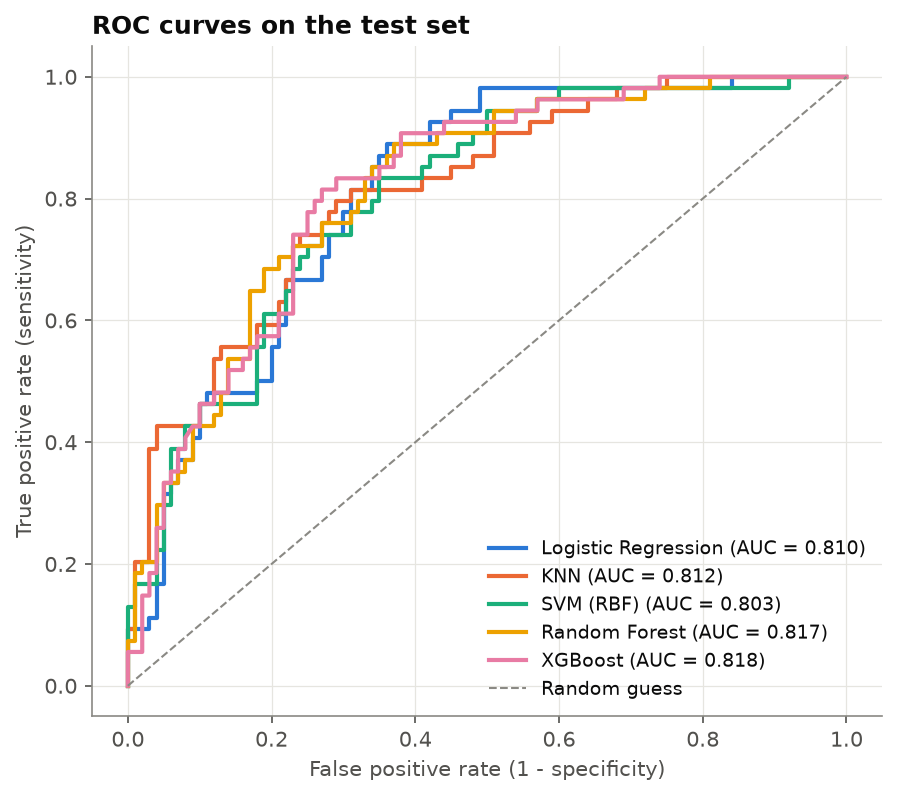
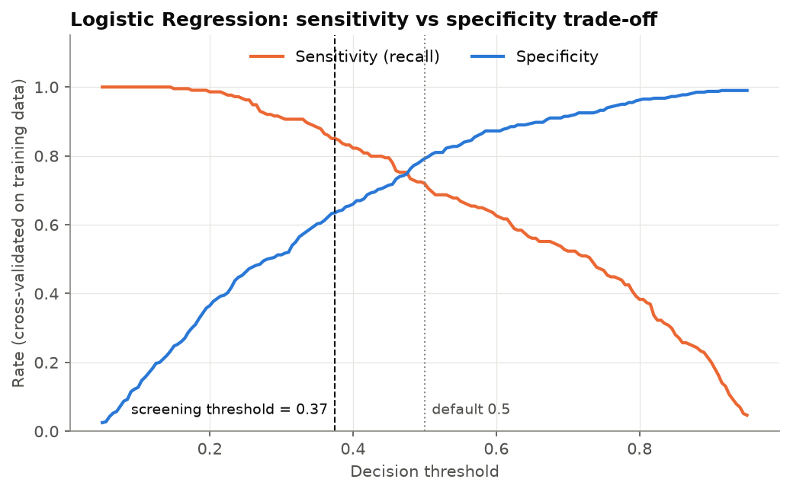
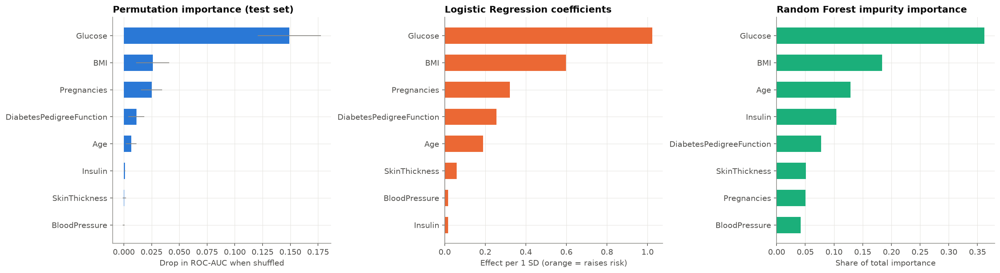
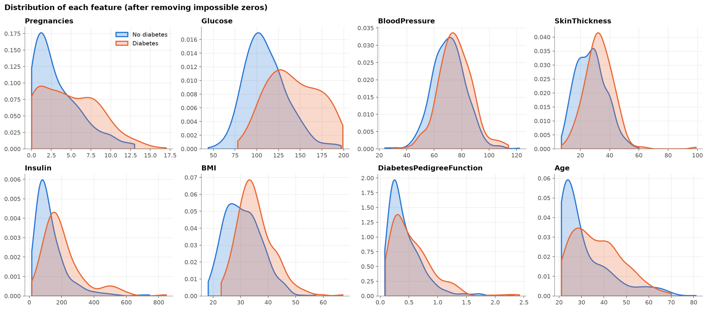

# Disease Risk Prediction: Diabetes

[](https://colab.research.google.com/github/sayleeraut/disease-risk-prediction/blob/main/diabetes_risk_prediction.ipynb)

This project predicts the risk of **diabetes** from routine medical measurements using the real **Pima Indians Diabetes** dataset. It covers cleaning of impossible values, normalisation, a comparison of **five classifiers**, **feature importance**, a **high-sensitivity screening threshold**, and a section on **ethics, bias and patient privacy**, including a subgroup fairness check.

## Goal

- Clean the data and handle **physiologically impossible values** (glucose, blood pressure or BMI of 0).
- Normalise the features and compare several classification models.
- Identify the most important risk factors.
- Discuss ethical data handling, bias and patient privacy.

## Dataset

**Pima Indians Diabetes Database**: 768 female patients aged 21 or older, of Pima Indian heritage, with 8 medical measurements and a diabetes outcome (35% positive).

- Originally from the **US National Institute of Diabetes and Digestive and Kidney Diseases (NIDDK)**, Smith et al. (1988), and a classic UCI/Kaggle benchmark
- Loaded from a public CSV: [jbrownlee/Datasets](https://github.com/jbrownlee/Datasets/blob/master/pima-indians-diabetes.data.csv), with an automatic fallback to [OpenML dataset 37](https://www.openml.org/d/37). Also on [Kaggle](https://www.kaggle.com/datasets/uciml/pima-indians-diabetes-database).
- The data is de-identified (no names, IDs or dates).

## Tools

Python 3.12, pandas, NumPy, Matplotlib, Seaborn, scikit-learn, XGBoost, Jupyter

## Approach

1. **Cleaning.** Found **652 impossible zeros** in Glucose (5), BloodPressure (35), SkinThickness (227), Insulin (374) and BMI (11). I converted them to missing values and **imputed them with training-set medians** inside the pipeline, so no data leaks from the test set.
2. **Normalisation.** `StandardScaler` (mean 0, SD 1), also inside the pipeline.
3. **EDA.** Outcome balance, feature distributions by outcome, glucose vs BMI, diabetes rate by age, and a correlation heatmap. Each chart has a written observation.
4. **Models.** Logistic Regression, KNN, SVM (RBF), Random Forest and XGBoost, each tuned with 5-fold stratified grid search on ROC-AUC, using class weighting where available.
5. **Screening threshold.** I chose the threshold that gives at least 85% sensitivity, using **out-of-fold predictions on the training set**, and only then applied it to the test set.
6. **Feature importance.** Permutation importance, Logistic Regression coefficients and Random Forest importance.
7. **Ethics.** Privacy (HIPAA, GDPR, DPDP), representation, measurement and label bias, an **age-group fairness check**, and responsible use.

## Results (test set, 154 patients, threshold 0.5)

| Model | CV ROC-AUC | Accuracy | Precision | Recall (sensitivity) | Specificity | F1 | ROC-AUC |
|---|---|---|---|---|---|---|---|
| Logistic Regression | **0.845** | 0.708 | 0.571 | 0.667 | 0.73 | 0.615 | 0.810 |
| KNN | 0.834 | 0.753 | 0.682 | 0.556 | **0.86** | 0.612 | 0.812 |
| SVM (RBF) | **0.845** | 0.727 | 0.625 | 0.556 | 0.82 | 0.588 | 0.803 |
| Random Forest | 0.840 | 0.727 | 0.586 | 0.759 | 0.71 | 0.661 | 0.817 |
| **XGBoost** | 0.840 | **0.760** | 0.627 | **0.778** | 0.75 | **0.694** | **0.818** |

- **XGBoost** has the best test scores at the default threshold (ROC-AUC 0.818, F1 0.694, sensitivity 0.78).
- All five models are within about 0.015 ROC-AUC of each other.
- **Logistic Regression** is the chosen **screening model**: it is tied for the best cross-validated AUC and is fully interpretable.

**Screening threshold (Logistic Regression):**

| Threshold | Sensitivity | Specificity | Missed diabetic patients | False alarms |
|---|---|---|---|---|
| Default 0.50 | 0.667 | 0.73 | 18 | 27 |
| **Screening 0.37** | **0.870** | 0.64 | **7** | 36 |

With the screening threshold, the model catches **47 of 54 diabetic patients** in the test set, at the cost of 9 extra confirmatory tests.

| ROC curves | Sensitivity vs specificity |
|---|---|
|  |  |





## Key insights

- **Glucose is the dominant risk factor.** Shuffling it drops test ROC-AUC by about 0.15. The median glucose is 140 mg/dL for diabetic patients against 107 for non-diabetic patients.
- **BMI comes second** (median 34 against 30), followed by **pregnancies, family history (pedigree function) and age**.
- **The diabetes rate rises sharply with age:** 17% at 21-25, and 48-57% at 31-50.
- Blood pressure, skin thickness and insulin add little once glucose and BMI are known.
- **The threshold matters more than the algorithm here.** All models rank patients similarly, but moving the threshold from 0.5 to 0.37 cuts missed cases from 18 to 7.
- **There is an age-related bias.** At the screening threshold the model catches 97% of diabetic patients aged 31+, but only 67% of those aged 21-30. It also flags many healthy older patients.

## Ethics, bias and privacy (summary)

- **Privacy.** Only public, de-identified research data is used, and it is downloaded at runtime, so no patient data is stored in this repo. Real deployments must follow HIPAA, GDPR or India's DPDP Act: consent, purpose limitation, data minimisation and secure storage.
- **Bias.** The model was trained only on **adult women from one Native American community**. It must not be assumed to work for men, children or other populations without re-validation.
- **Responsible use.** The model is a **screening aid, not a diagnosis**. A positive flag should lead to a clinical test (such as HbA1c), and the clinician makes the final decision.

The full discussion is in section 9 of the notebook.

## How to run

**In Google Colab:** click the badge above, then choose **Runtime → Run all**. The first cell installs any missing packages, and the data downloads automatically.

**Locally:**

```bash
git clone https://github.com/sayleeraut/disease-risk-prediction.git
cd disease-risk-prediction
python -m venv venv
# Windows: venv\Scripts\activate   |   macOS/Linux: source venv/bin/activate
pip install -r requirements.txt
jupyter notebook diabetes_risk_prediction.ipynb
```

To re-run everything from the command line:

```bash
jupyter nbconvert --to notebook --execute --inplace diabetes_risk_prediction.ipynb
```

Seeds are fixed (`SEED = 42`), so the results are reproducible.

## Project structure

```
disease-risk-prediction/
├── diabetes_risk_prediction.ipynb   # main notebook (executed, with outputs)
├── images/                          # charts saved by the notebook + results_table.csv
├── requirements.txt
└── README.md
```
